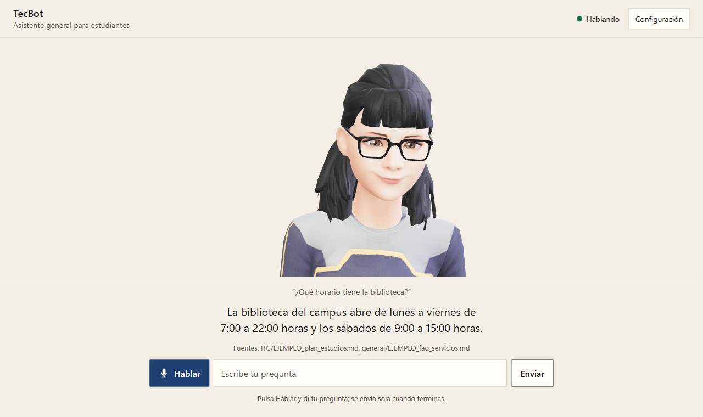

# Asistente Tec

MVP de un asistente virtual con avatar en video para estudiantes. Contesta por voz o por texto con información de una base de conocimiento propia, en cinco idiomas, y puede entrar a una reunión de Microsoft Teams con su avatar y su voz.

Todo corre en una sola computadora, con modelos de código o pesos abiertos, sin servicios de pago ni cuentas externas.



## Qué hace

- Responde preguntas con una base de conocimiento propia (RAG) y cita de qué documentos sale la respuesta.
- Dice cuando no tiene la información y sugiere validarla con una fuente institucional.
- Conversa por voz o por texto y recuerda el contexto de la sesión.
- Habla español, inglés, francés, sueco y alemán.
- Tiene un avatar 3D con labios sincronizados con la voz.
- Permite varios asistentes, cada uno con su función, personalidad, voz, personaje y acceso a documentos.
- Entra a reuniones de Teams como invitado y contesta cuando dicen su nombre.
- Incluye una consola de administración para documentos, preguntas frecuentes, asistentes, pruebas, historial y reuniones.

## Instalación rápida

Requisitos: Windows 10 u 11, Python 3.10 o posterior, una GPU NVIDIA con 12 GB de memoria o más y unos 25 GB de disco. El porqué de la GPU está en [docs/arquitectura.md](docs/arquitectura.md#por-qué-gpu-y-por-qué-local).

```powershell
powershell -ExecutionPolicy Bypass -File instalar.ps1
```

Para encenderlo:

```powershell
.\iniciar.bat
```

Se abre la consola en `http://localhost:8501`. La página del avatar queda en `http://localhost:8000/avatar/`.

El paso a paso, la instalación manual y la solución de problemas están en [docs/instalacion.md](docs/instalacion.md).

## Documentación

| Documento | Contenido |
|---|---|
| [Instalación y configuración](docs/instalacion.md) | Requisitos, instalador, instalación manual, variables de configuración, problemas comunes |
| [Arquitectura y tecnologías](docs/arquitectura.md) | Diagrama, componentes, flujo de una pregunta, tecnologías y licencias, por qué GPU y por qué local |
| [Manual de la consola](docs/manual_consola.md) | Uso de cada sección y cómo agregar o actualizar información |
| [Integración con Teams](docs/teams.md) | Cómo entra a una reunión, qué se probó y qué límites tiene |
| [Demostración](docs/demostracion.md) | Guion para mostrar cada requisito del encargo y pruebas que lo respaldan |
| [Evolución del MVP](docs/evolucion.md) | Recomendaciones para llevarlo a una solución institucional |

## Estado

Es un prototipo. Lo más importante que falta:

- La base de conocimiento inicial son dos documentos de ejemplo con datos ficticios. Hay que cargar los documentos reales desde la consola.
- La consola no pide usuario ni contraseña.
- La entrada a Teams funciona en reuniones de cuentas personales. En las de la cuenta institucional del Tec el asistente no entra, porque exigen iniciar sesión y el asistente solo entra como invitado.
- Cuatro de los cinco personajes 3D tienen licencia solo para uso no comercial.

## Estructura

```
app/        API, RAG, voz, perfiles, consola y conexión a Teams
web/        Página del avatar
data/       Documentos, perfiles, preguntas frecuentes, voces e índice
scripts/    Descargas, revisión de la instalación y lanzadores para OBS
tests/      Evaluación de respuestas y pruebas de voz, acceso y reuniones
docs/       Documentación
```
