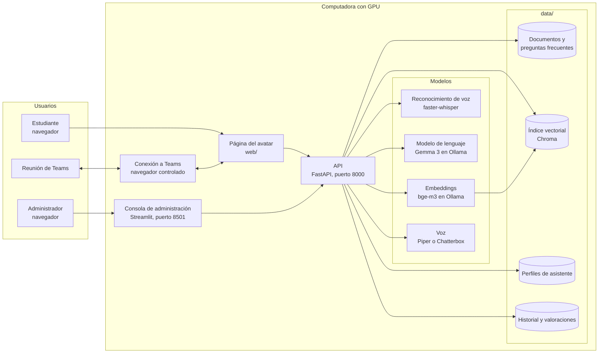
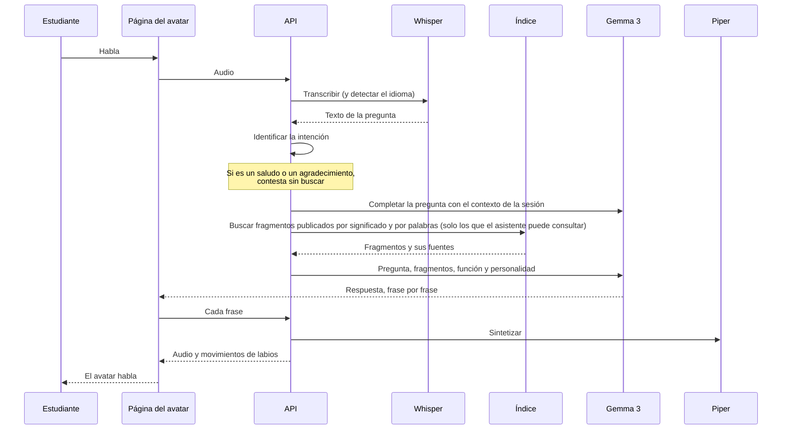
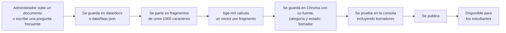

# Arquitectura y tecnologías

## Diagrama

Todo corre en una computadora. Las tres caras del sistema (página del avatar, consola y conexión a Teams) hablan con una sola API, que es la que usa los modelos y los datos.

## Componentes

| Componente | Archivos | Qué hace |
|---|---|---|
| API | `app/api/` | Punto único de entrada, dividido por tema: `conversation`, `speech`, `assistants`, `knowledge`, `quality`, `meetings`. `security.py` exige la clave en las rutas de administración |
| Configuración | `app/config.py`, `.env` | Todos los valores ajustables, leídos de `.env` o del entorno |
| Intención | `app/intent.py` | Distingue saludos, despedidas y agradecimientos de las consultas |
| RAG | `app/rag.py`, `app/prompts.py`, `app/store.py`, `app/ingest.py` | Parte los documentos en fragmentos, los indexa, recupera los más parecidos a la pregunta y arma la respuesta. Las instrucciones al modelo están aparte, en `prompts.py` |
| Sesiones | `app/sessions.py` | Memoria de la conversación, con límite de turnos, caducidad y tope de sesiones |
| Publicación | `app/publication.py` | Borradores y publicación de documentos y preguntas frecuentes |
| Búsqueda por palabras | `app/keyword.py` | BM25 y fusión con la búsqueda por vectores |
| Importación web | `app/web_import.py` | Descarga páginas públicas y guarda su texto como documento en borrador |
| Voz | `app/voice.py`, `app/lipsync.py` | Voz a texto, texto a voz y cálculo de los movimientos de labios |
| Perfiles | `app/profiles.py` | Asistentes con función, personalidad, voz, personaje y acceso a documentos |
| Personajes | `app/avatars.py` | Personajes de ejemplo y los subidos desde la consola |
| Activación por nombre | `app/wake.py` | En una reunión, decide si una frase va dirigida al asistente |
| Página del avatar | `web/` | Personaje 3D, micrófono, subtítulos, valoración 👍 / 👎, detección de idioma y modo reunión. three.js, TalkingHead y HeadAudio vienen en `web/vendor/` |
| Consola | `app/consola.py` | Administración sin tocar código |
| Conexión a Teams | `app/teams.py`, `app/teams_puente.js`, `web/puente.js` | Entra a la reunión con un navegador controlado y lleva la imagen y el audio |

## Flujo de una pregunta por voz

Detalles que importan:

- **Intención.** Una frase hecha solo de palabras de cortesía ("hola", "muchas gracias", "adiós") se contesta sin buscar en los documentos: es más rápido y no cita fuentes que no vienen al caso. Cualquier otra cosa es una consulta. La regla es deliberadamente conservadora: "Hola, ¿qué horario tiene la biblioteca?" es una consulta.
- **Idioma.** Al hablar en la página del avatar, Whisper detecta el idioma. Si es uno de los cinco del asistente y está seguro, la respuesta y la voz cambian a ese idioma.
- **Preguntas de seguimiento.** Antes de buscar, el modelo reescribe la pregunta para que se entienda sola. Así "¿y si ya pasó esa fecha?" se busca como una pregunta completa.
- **Respuesta por partes.** La voz empieza con la primera frase mientras el modelo sigue escribiendo las demás.
- **Cuando no sabe.** Si los fragmentos no contestan la pregunta, el asistente lo dice y sugiere validar con una fuente institucional. Esa respuesta se marca como no contestada en el historial.
- **Búsqueda híbrida.** Se busca por significado (vectores de bge-m3) y por palabras exactas (BM25, `app/keyword.py`), y las dos listas se combinan con Reciprocal Rank Fusion. Así una pregunta por "TC1001" o "ITC" encuentra el fragmento que tiene esa clave aunque los vectores lo confundan. Se apaga con `HYBRID_SEARCH=false`.
- **Acceso por asistente y borradores.** El filtro de documentos y el de "solo publicados" se aplican al buscar, antes de que el modelo vea nada. Lo que un asistente no puede consultar, o lo que sigue en borrador, no llega a su respuesta. La consola puede incluir los borradores para probar.
- **Memoria de la sesión.** Cada conversación guarda solo los turnos que se le mandan al modelo y se olvida tras una hora sin uso (`SESSION_TTL_MINUTES`).
- **Labios.** El servidor calcula los movimientos a partir del audio ya sintetizado, con los tiempos de cada palabra.

## Flujo de administración

Los cambios aplican de inmediato, sin reiniciar nada. Los vectores se calculan antes de tocar el índice: si el modelo falla al reemplazar un documento, la versión anterior sigue disponible.

## Tecnologías

| Función | Tecnología | Licencia | Por qué |
|---|---|---|---|
| Modelo de lenguaje | Gemma 3 de 12 mil millones de parámetros | Gemma Terms of Use (pesos abiertos) | Buen español y cabe en 16 GB junto con lo demás |
| Servidor de modelos | Ollama | MIT | Instalación de un paso y API compatible con OpenAI |
| Embeddings | bge-m3 | MIT | Multilingüe: sirve para los cinco idiomas |
| Base vectorial | Chroma | Apache 2.0 | Se guarda en una carpeta, sin servidor aparte |
| Reconocimiento de voz | faster-whisper con Whisper large-v3-turbo | MIT | Rápido en GPU y reconoce los cinco idiomas |
| Voz rápida | Piper | GPL 3.0 | Corre en procesador, sin gastar GPU |
| Voz natural (opcional) | Chatterbox Multilingual | MIT | Más humana y permite clonar una voz de referencia |
| Avatar 3D | TalkingHead sobre three.js (incluidos en `web/vendor/`) | MIT | Corre en el navegador, sin generar video en el servidor ni depender de internet |
| Lectura de documentos | pypdf, python-docx, openpyxl, python-pptx | BSD / MIT | PDF, Word, Excel y PowerPoint |
| Importar páginas web | trafilatura (y Playwright para páginas con JavaScript) | Apache 2.0 | Extrae el texto principal sin menús ni pies de página |
| Búsqueda por palabras | BM25 y Reciprocal Rank Fusion, sin librerías | Propio | Encuentra siglas, claves y números que los vectores confunden |
| Pruebas | pytest y ruff | MIT | Pruebas unitarias sin modelos y revisión de estilo |
| API | FastAPI | MIT | |
| Consola | Streamlit | Apache 2.0 | Interfaz de administración con poco código |
| Entrada a Teams | Playwright con Chrome o Edge | Apache 2.0 | Controla un navegador real, sin cuentas ni permisos de Microsoft |

No se usa ningún servicio de pago ni ninguna API externa. Gemma 3 no es código abierto en sentido estricto: sus pesos son de libre descarga con condiciones de uso de Google. Si se requiere una licencia abierta sin condiciones, el modelo se cambia con una variable (ver [instalacion.md](instalacion.md#configuración)).

Los personajes 3D son ejemplos del proyecto TalkingHead. Solo uno (Lucía) es de dominio público; los otros cuatro son para uso no comercial. Las voces de Piper tienen cada una su propia licencia.

## Por qué GPU y por qué local

### Por qué local

El encargo pide priorizar tecnologías de código abierto y prevé instalar los modelos en un servidor propio con GPU. Además, el equipo decidió trabajar por ahora solo con código abierto. De ahí sale que todo corra en una computadora:

- **Sin costo por uso.** No hay cobro por pregunta, por minuto de voz ni por minuto de avatar.
- **Los datos no salen.** Los documentos institucionales, las preguntas de los estudiantes y su voz se procesan en la misma máquina.
- **Sin cuentas ni llaves.** Instalar no depende de contratar ni configurar servicios de terceros.
- **Reproducible.** Cualquier persona con el equipo adecuado lo instala con un comando.

El costo de esta decisión es que hace falta una computadora potente, y que atiende a pocas personas a la vez.

### Por qué GPU

Una conversación por voz solo se siente natural si la respuesta empieza en pocos segundos. En cada pregunta trabajan tres modelos seguidos:

| Modelo | Memoria de video | Para qué |
|---|---|---|
| Gemma 3 de 12B | unos 8 a 9 GB | Entender la pregunta y redactar la respuesta |
| bge-m3 | unos 1.2 GB | Buscar en los documentos |
| Whisper large-v3-turbo | unos 1.5 GB | Transcribir la voz |
| **Total medido** | **11.7 GB** | Con la voz de Piper, que va por procesador |

El total se midió con los tres modelos cargados; el reparto por modelo es aproximado.

Con la voz natural de Chatterbox y el avatar a la vez, el uso sube a unos 15.5 GB de los 16 GB disponibles.

Tiempos medidos en la computadora de desarrollo (RTX 4090 de laptop, 16 GB):

| Medida | Resultado |
|---|---|
| Transcribir una frase | unos 0.2 segundos |
| Desde que termina la pregunta hasta que el asistente empieza a hablar, en reunión | 3.5 a 3.7 segundos |

De esos 3.5 segundos, 0.9 son la espera de silencio que confirma que la persona terminó de hablar.

No se midió el sistema sin GPU. Un modelo de 12 mil millones de parámetros en procesador escribe pocas palabras por segundo, lo que haría esperar mucho más antes de cada respuesta; por eso no se considera viable para voz. Para texto, o con un modelo más chico, sí podría funcionar.

### Cómo se repartió la carga

- La voz de Piper corre en procesador, para dejar la GPU a los tres modelos de arriba.
- El avatar se dibuja en el navegador de quien lo ve, no en el servidor.
- Whisper usa una versión comprimida (`int8_float16`) que ocupa menos memoria.

### Pasar a un servidor

La arquitectura no obliga a que todo esté en una computadora. Los modelos de lenguaje se consumen por una API estándar, así que basta cambiar dos variables (`LLM_BASE_URL` y `EMBED_BASE_URL`) para apuntar a un servidor con GPU. Las recomendaciones para ese paso están en [evolucion.md](evolucion.md).

## Decisiones de seguridad

- **Teams solo como invitado.** El asistente nunca abre la aplicación de Teams instalada ni usa cuentas de la computadora. Si el navegador inicia sesión solo o la reunión exige iniciar sesión, cancela la entrada. Detalles en [teams.md](teams.md).
- **No se oculta que es un programa.** No se disfraza la automatización ni se intentan pasar verificaciones.
- **Acceso por asistente en la búsqueda**, no en las instrucciones al modelo.
- **Clave de administración.** Con `ADMIN_TOKEN` en `.env`, la consola pide la clave y la API rechaza las rutas de administración sin ella. La conversación, la voz y la valoración siguen abiertas para los estudiantes. Es una sola clave para todos: no hay usuarios ni roles.
- **Archivos subidos.** Se limpia el nombre (sin rutas), se limita el tamaño y solo se aceptan los formatos soportados; un personaje debe ser un `.glb` de verdad.
- **Enlaces de Teams.** Solo se aceptan enlaces `https://` de los dominios de Teams exactos (no basta con que el dominio termine en el mismo texto).
