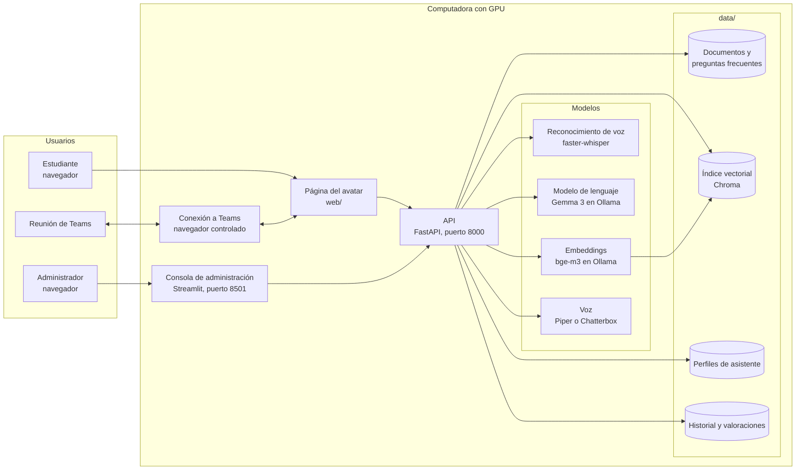
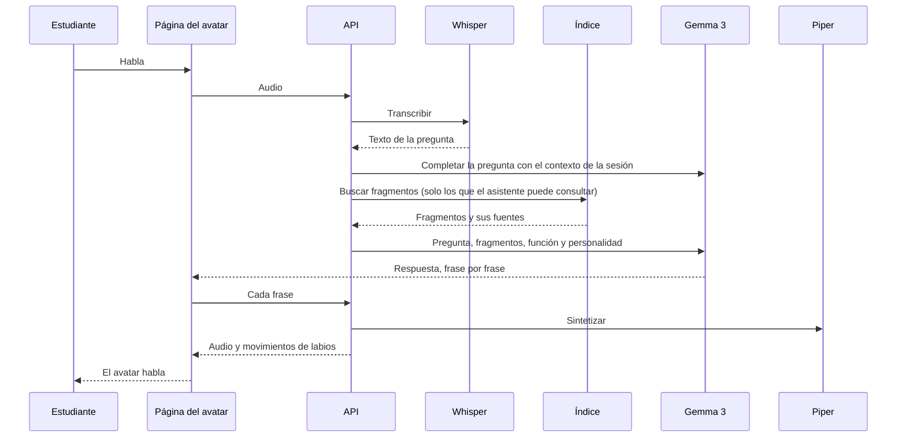
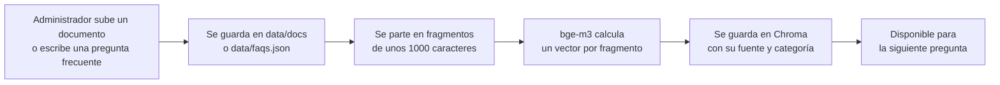

# Arquitectura y tecnologías

## Diagrama

Todo corre en una computadora. Las tres caras del sistema (página del avatar, consola y conexión a Teams) hablan con una sola API, que es la que usa los modelos y los datos.

## Componentes

| Componente | Archivos | Qué hace |
|---|---|---|
| API | `app/api.py` | Punto único de entrada: conversación, voz, perfiles, documentos, preguntas frecuentes, historial y reuniones |
| RAG | `app/rag.py`, `app/store.py`, `app/ingest.py` | Parte los documentos en fragmentos, los indexa, recupera los más parecidos a la pregunta y arma la respuesta |
| Voz | `app/voice.py`, `app/lipsync.py` | Voz a texto, texto a voz y cálculo de los movimientos de labios |
| Perfiles | `app/profiles.py` | Asistentes con función, personalidad, voz, personaje y acceso a documentos |
| Activación por nombre | `app/wake.py` | En una reunión, decide si una frase va dirigida al asistente |
| Página del avatar | `web/` | Personaje 3D, micrófono, subtítulos y modo reunión |
| Consola | `app/consola.py` | Administración sin tocar código |
| Conexión a Teams | `app/teams.py`, `app/teams_puente.js`, `web/puente.js` | Entra a la reunión con un navegador controlado y lleva la imagen y el audio |

## Flujo de una pregunta por voz

Detalles que importan:

- **Preguntas de seguimiento.** Antes de buscar, el modelo reescribe la pregunta para que se entienda sola. Así "¿y si ya pasó esa fecha?" se busca como una pregunta completa.
- **Respuesta por partes.** La voz empieza con la primera frase mientras el modelo sigue escribiendo las demás.
- **Cuando no sabe.** Si los fragmentos no contestan la pregunta, el asistente lo dice y sugiere validar con una fuente institucional. Esa respuesta se marca como no contestada en el historial.
- **Acceso por asistente.** El filtro de documentos se aplica al buscar, antes de que el modelo vea nada. Lo que un asistente no puede consultar no llega a su respuesta.
- **Labios.** El servidor calcula los movimientos a partir del audio ya sintetizado, con los tiempos de cada palabra.

## Flujo de administración

Los cambios aplican de inmediato, sin reiniciar nada.

## Tecnologías

| Función | Tecnología | Licencia | Por qué |
|---|---|---|---|
| Modelo de lenguaje | Gemma 3 de 12 mil millones de parámetros | Gemma Terms of Use (pesos abiertos) | Buen español y cabe en 16 GB junto con lo demás |
| Servidor de modelos | Ollama | MIT | Instalación de un paso y API compatible con OpenAI |
| Embeddings | bge-m3 | MIT | Multilingüe: sirve para los cinco idiomas |
| Base vectorial | Chroma | Apache 2.0 | Se guarda en una carpeta, sin servidor aparte |
| Reconocimiento de voz | faster-whisper con Whisper large-v3-turbo | MIT | Rápido en GPU y reconoce los cinco idiomas |
| Voz rápida | Piper | GPL 3.0 | Corre en procesador, sin gastar GPU |
| Voz natural (opcional) | Chatterbox Multilingual | MIT | Más humana y permite clonar una voz de referencia |
| Avatar 3D | TalkingHead sobre three.js | MIT | Corre en el navegador, sin generar video en el servidor |
| API | FastAPI | MIT | |
| Consola | Streamlit | Apache 2.0 | Interfaz de administración con poco código |
| Entrada a Teams | Playwright con Chrome o Edge | Apache 2.0 | Controla un navegador real, sin cuentas ni permisos de Microsoft |

No se usa ningún servicio de pago ni ninguna API externa. Gemma 3 no es código abierto en sentido estricto: sus pesos son de libre descarga con condiciones de uso de Google. Si se requiere una licencia abierta sin condiciones, el modelo se cambia con una variable (ver [instalacion.md](instalacion.md#configuración)).

Los personajes 3D son ejemplos del proyecto TalkingHead. Solo uno (Lucía) es de dominio público; los otros cuatro son para uso no comercial. Las voces de Piper tienen cada una su propia licencia.

## Por qué GPU y por qué local

### Por qué local

El encargo pide priorizar tecnologías de código abierto y prevé instalar los modelos en un servidor propio con GPU. Además, el equipo decidió trabajar por ahora solo con código abierto. De ahí sale que todo corra en una computadora:

- **Sin costo por uso.** No hay cobro por pregunta, por minuto de voz ni por minuto de avatar.
- **Los datos no salen.** Los documentos institucionales, las preguntas de los estudiantes y su voz se procesan en la misma máquina.
- **Sin cuentas ni llaves.** Instalar no depende de contratar ni configurar servicios de terceros.
- **Reproducible.** Cualquier persona con el equipo adecuado lo instala con un comando.

El costo de esta decisión es que hace falta una computadora potente, y que atiende a pocas personas a la vez.

### Por qué GPU

Una conversación por voz solo se siente natural si la respuesta empieza en pocos segundos. En cada pregunta trabajan tres modelos seguidos:

| Modelo | Memoria de video | Para qué |
|---|---|---|
| Gemma 3 de 12B | unos 8 a 9 GB | Entender la pregunta y redactar la respuesta |
| bge-m3 | unos 1.2 GB | Buscar en los documentos |
| Whisper large-v3-turbo | unos 1.5 GB | Transcribir la voz |
| **Total medido** | **11.7 GB** | Con la voz de Piper, que va por procesador |

El total se midió con los tres modelos cargados; el reparto por modelo es aproximado.

Con la voz natural de Chatterbox y el avatar a la vez, el uso sube a unos 15.5 GB de los 16 GB disponibles.

Tiempos medidos en la computadora de desarrollo (RTX 4090 de laptop, 16 GB):

| Medida | Resultado |
|---|---|
| Transcribir una frase | unos 0.2 segundos |
| Desde que termina la pregunta hasta que el asistente empieza a hablar, en reunión | 3.5 a 3.7 segundos |

De esos 3.5 segundos, 0.9 son la espera de silencio que confirma que la persona terminó de hablar.

No se midió el sistema sin GPU. Un modelo de 12 mil millones de parámetros en procesador escribe pocas palabras por segundo, lo que haría esperar mucho más antes de cada respuesta; por eso no se considera viable para voz. Para texto, o con un modelo más chico, sí podría funcionar.

### Cómo se repartió la carga

- La voz de Piper corre en procesador, para dejar la GPU a los tres modelos de arriba.
- El avatar se dibuja en el navegador de quien lo ve, no en el servidor.
- Whisper usa una versión comprimida (`int8_float16`) que ocupa menos memoria.

### Pasar a un servidor

La arquitectura no obliga a que todo esté en una computadora. Los modelos de lenguaje se consumen por una API estándar, así que basta cambiar dos variables (`LLM_BASE_URL` y `EMBED_BASE_URL`) para apuntar a un servidor con GPU. Las recomendaciones para ese paso están en [evolucion.md](evolucion.md).

## Decisiones de seguridad

- **Teams solo como invitado.** El asistente nunca abre la aplicación de Teams instalada ni usa cuentas de la computadora. Si el navegador inicia sesión solo o la reunión exige iniciar sesión, cancela la entrada. Detalles en [teams.md](teams.md).
- **No se oculta que es un programa.** No se disfraza la automatización ni se intentan pasar verificaciones.
- **Acceso por asistente en la búsqueda**, no en las instrucciones al modelo.
- **Sin autenticación en la consola.** Es una limitación conocida del MVP: quien llegue a la dirección puede administrar.
