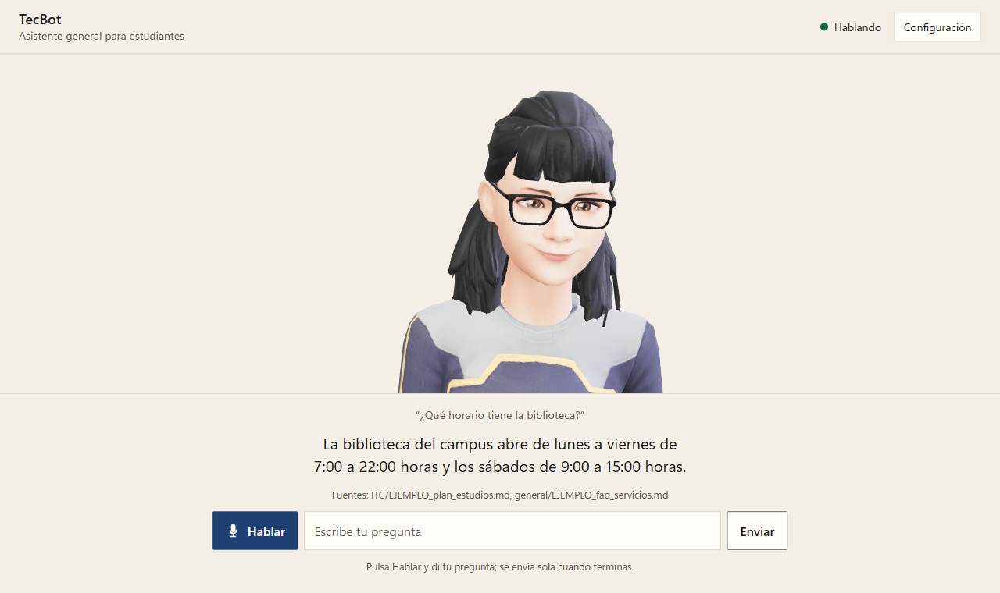

# Asistente Tec: resumen para revisión

Asistente virtual con avatar 3D que contesta por voz o por texto las preguntas de los estudiantes, con información de una base de conocimiento propia (RAG), en cinco idiomas. Tiene una consola para administrarlo sin tocar código y puede entrar a reuniones de Microsoft Teams. Todo corre en una sola computadora con modelos abiertos, sin servicios de pago.

## Cumplimiento del encargo

### Mínimo a demostrar

| Requisito | Estado | Cómo se cumple |
|---|---|---|
| Interacción por voz y texto | ✅ | Página del avatar: botón Hablar o caja de texto |
| Respuestas generadas con IA | ✅ | Gemma 3 en Ollama |
| Base de conocimiento con RAG | ✅ | Documentos y preguntas frecuentes indexados; búsqueda por significado y por palabras exactas; cita la fuente |
| Respuesta mediante avatar con voz | ✅ | Personaje 3D con labios sincronizados (TalkingHead, Piper, Whisper) |
| Español e inglés | ✅ | Además francés, sueco y alemán; detecta el idioma de quien habla |
| Personalización de avatar y voz | ✅ | Cinco personajes, personajes propios (`.glb`), voz por idioma |
| Consola de administración | ✅ | Documentos, preguntas frecuentes, asistentes, personajes, pruebas, historial y reuniones |
| Evidencia de integración con Teams | ✅ con límite | Entra como invitado a reuniones de cuentas personales, escucha y contesta cuando dicen su nombre. No entra a reuniones de la cuenta institucional (ver abajo) |

### Funcionalidades

| Requisito | Estado | Detalle |
|---|---|---|
| Preguntas sobre el Tec, la Escuela, programas, planes, materias, servicios y certificaciones | ⚠️ | El sistema lo soporta, pero la base de conocimiento inicial son dos documentos de ejemplo. Falta cargar documentos oficiales (la consola ya importa PDF, Word, Excel y páginas web) |
| Conversación de varios turnos | ✅ | Recuerda la conversación y completa preguntas de seguimiento ("¿y cuánto tarda?") |
| Indicar cuando no sabe | ✅ | Lo dice y sugiere validarlo con una fuente institucional; queda registrado para saber qué falta |
| Identidad o perfil del asistente | ✅ | Varios asistentes con función, personalidad, voz, personaje y documentos a los que puede acceder |
| Identificación de la intención | ✅ | Distingue la conversación casual de las consultas |

### Consola

| Requisito | Estado |
|---|---|
| Cargar PDF, Word, Excel o texto (también PowerPoint, CSV y páginas web) | ✅ |
| Agregar, editar y eliminar preguntas frecuentes | ✅ |
| Clasificar por programa, tema o categoría | ✅ |
| Configurar idioma, perfil, voz y avatar | ✅ |
| Ver los documentos disponibles y su contenido indexado | ✅ |
| Probar preguntas y respuestas antes de publicar | ✅ Lo nuevo queda en borrador hasta publicarlo |
| Deseables: historial, preguntas sin respuesta, estadísticas, retroalimentación, varios asistentes | ✅ Todas, con valoración 👍/👎 de los estudiantes y exportación a CSV |

### Entregables de documentación

| Entregable | Documento |
|---|---|
| Instalación y configuración | [instalacion.md](instalacion.md) e instalador automático para Windows |
| Diagrama de arquitectura y tecnologías | [arquitectura.md](arquitectura.md) |
| Base de conocimiento inicial | Dos documentos de ejemplo en `data/docs` (ver pendientes) |
| Manual de la consola e instrucciones para actualizar información | [manual_consola.md](manual_consola.md) |
| Demostración funcional | [demostracion.md](demostracion.md) |
| Recomendaciones para evolucionar a una solución institucional | [evolucion.md](evolucion.md) y [herramientas.md](herramientas.md) |

## Tecnologías

Gemma 3 (Ollama) para el lenguaje, bge-m3 para buscar en los documentos, faster-whisper para entender la voz, Piper para hablar, TalkingHead sobre three.js para el avatar, FastAPI para el servidor, Streamlit para la consola y Playwright para entrar a Teams. Todas son de código o pesos abiertos. Detalle y licencias en [arquitectura.md](arquitectura.md#tecnologías).

## Teams: qué funciona y qué faltaría

El asistente abre Teams web en un navegador controlado y entra como invitado, con el avatar como cámara y su voz como micrófono. Funciona en reuniones de cuentas personales de Microsoft.

En reuniones de la cuenta institucional del Tec no entra, porque piden iniciar sesión y el asistente no usa cuentas por diseño. Las opciones son:

1. Que TI permita invitados anónimos en esas reuniones (sin cambios de código).
2. Una cuenta institucional dedicada al asistente, autorizada por TI (cambio menor de código).
3. Un bot oficial de Teams con Microsoft Graph, alojado en Azure (semanas de trabajo y permisos de TI).

Detalles en [teams.md](teams.md).

## Pendientes

- **Base de conocimiento real.** Cargar planes de estudio, reglamentos y preguntas frecuentes oficiales y nombrar responsables de mantenerlos.
- **Teams institucional**, con una de las tres opciones de arriba.
- **Personajes con licencia propia.** Cuatro de los cinco de ejemplo son de uso no comercial.
- **Servidor con GPU** para atender a varias personas a la vez y usar el modelo de lenguaje grande.

## Cómo probarlo

En Windows: `instalar.ps1` y luego `iniciar.bat` (ver [instalacion.md](instalacion.md)). La consola queda en `http://localhost:8501` y el avatar en `http://localhost:8000/avatar/`. El guion de demostración de 15 minutos está en [demostracion.md](demostracion.md).
