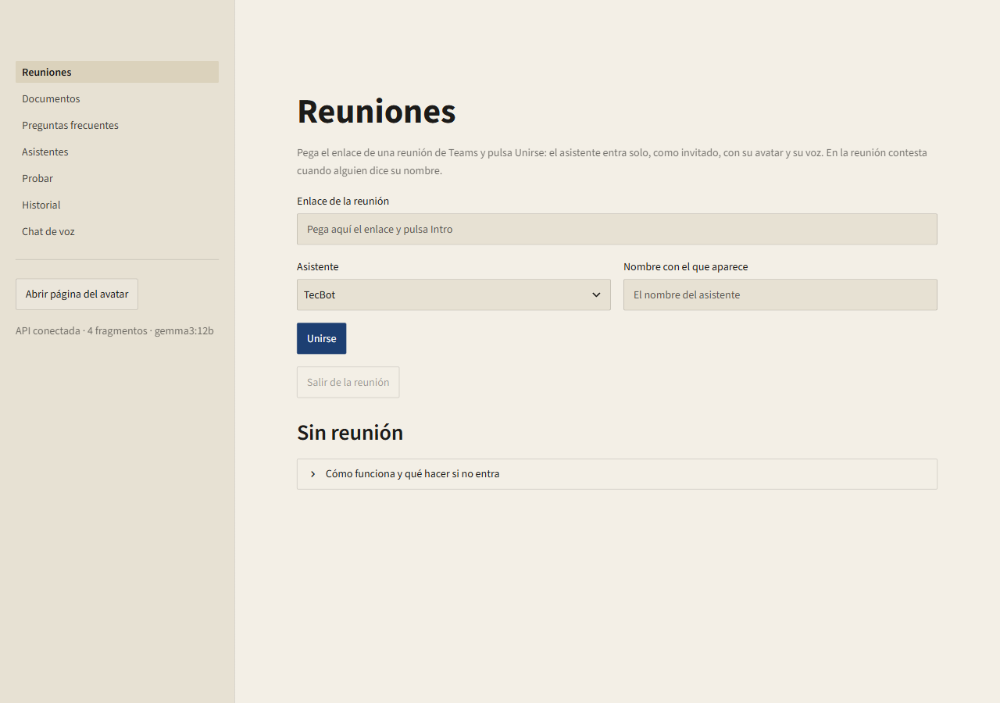
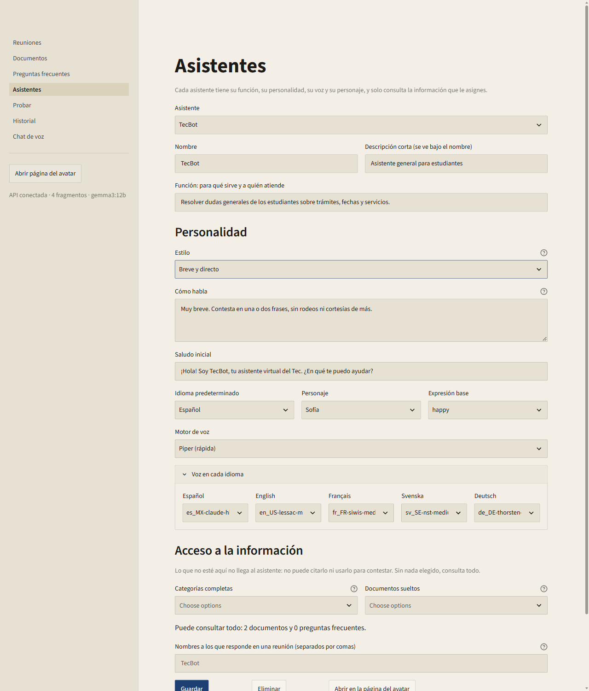

# Manual de la consola de administración

La consola sirve para administrar el asistente sin tocar código. Se abre en `http://localhost:8501` cuando el asistente está encendido (ver [instalacion.md](instalacion.md#encender-y-apagar)).

No pide usuario ni contraseña. Los cambios aplican de inmediato.

El menú de la izquierda tiene siete secciones. Abajo del menú aparece el estado de la conexión con la API y cuántos fragmentos hay indexados.

## Cómo agregar o actualizar información

Es la tarea más frecuente. Hay dos caminos.

### Subir un documento

1. Entra a **Documentos**.
2. Elige el archivo. Formatos: PDF, Word (`.docx`), Excel (`.xlsx`), texto (`.txt`) y Markdown (`.md`).
3. Elige una categoría existente o escribe una nueva, por ejemplo el programa (`ITC`, `IMT`) o el tema (`becas`, `servicios`).
4. Pulsa subir. El documento se guarda, se parte en fragmentos y se indexa.

El asistente puede usarlo desde la siguiente pregunta.

### Actualizar un documento

Sube el archivo nuevo con el mismo nombre y la misma categoría. Sustituye al anterior y se vuelve a indexar.

### Quitar un documento

En la lista de **Documentos**, selecciónalo y pulsa eliminar. Se borra el archivo y sus fragmentos.

### Agregar una pregunta frecuente

Sirve para respuestas cortas que no vienen en ningún documento.

1. Entra a **Preguntas frecuentes**.
2. Escribe la pregunta, la respuesta y la categoría.
3. Guarda.

El asistente la usa igual que un documento y la cita como fuente.

### Reindexar todo

El botón de reindexar en **Documentos** vuelve a procesar toda la carpeta `data/docs` y las preguntas frecuentes. Úsalo si copiaste archivos a mano en esa carpeta.

### Recomendaciones para los documentos

- Un tema por documento, con títulos claros. El asistente cita el nombre del archivo.
- Texto real, no imágenes escaneadas: de un PDF escaneado no se extrae nada.
- En Excel, una fila por dato y encabezados en la primera fila.
- Fechas completas ("del 3 al 7 de agosto de 2026"), no relativas ("la próxima semana").
- Después de subir algo, pruébalo en la sección **Probar** antes de darlo por bueno.

### Base de conocimiento inicial

El proyecto trae dos documentos de ejemplo con datos ficticios, marcados con `EJEMPLO_` en el nombre:

| Archivo | Categoría | Contenido |
|---|---|---|
| `EJEMPLO_faq_servicios.md` | `general` | Servicios para estudiantes: biblioteca, constancias, baja de materias, asesoría y certificaciones |
| `EJEMPLO_plan_estudios.md` | `ITC` | Plan de estudios de una carrera |

Sirven para probar y demostrar. Antes de un uso real hay que borrarlos y cargar los documentos institucionales.

## Secciones

### Reuniones

Para que el asistente entre a una reunión de Teams.

1. Pega el enlace de la reunión.
2. Elige el asistente y, si quieres, el nombre con el que aparecerá.
3. Pulsa Intro o **Unirse**.

Debajo se ve el estado: preparando, entrando, en la sala de espera, en la reunión o terminada. **Salir de la reunión** lo saca.

Requisitos y límites en [teams.md](teams.md).

### Documentos

Lista de los archivos de la base de conocimiento, con su categoría, tamaño y número de fragmentos. Permite subir, eliminar, ver los fragmentos de un documento y reindexar.

Ver los fragmentos sirve para comprobar que el texto se extrajo bien, sobre todo en PDF y Excel.

### Preguntas frecuentes

Agregar, editar y eliminar preguntas con su respuesta y su categoría.

### Asistentes

Cada asistente es un perfil independiente. Se pueden crear tantos como programas o servicios haya.

| Campo | Para qué |
|---|---|
| Nombre | Cómo se presenta y a qué nombre responde en una reunión |
| Descripción corta | Se ve bajo el nombre en la página del avatar |
| Función | Para qué sirve y a quién atiende. Se le da al modelo como instrucción |
| Estilo y cómo habla | La personalidad. Hay cuatro estilos predefinidos (Cercano, Formal, Breve y directo, Paciente y didáctico) y el texto se puede ajustar |
| Saludo inicial | Lo que dice al empezar |
| Idioma predeterminado | El idioma con el que arranca |
| Personaje y expresión base | La apariencia del avatar |
| Motor de voz y voz en cada idioma | Piper (rápida) o Chatterbox (natural, si está instalada) |
| Acceso a la información | Qué puede consultar |
| Nombres en reunión | Variantes del nombre a las que responde en Teams |

**Acceso a la información.** Se eligen categorías completas, documentos sueltos, o ambos. Sin nada elegido, el asistente consulta todo. Lo que no está asignado no le llega: no puede citarlo ni usarlo. Debajo aparece cuántos documentos y preguntas frecuentes puede consultar.

**La personalidad solo cambia el tono.** No cambia los datos ni la regla de contestar únicamente con la información disponible.

Para crear uno, elige "Nuevo…" en la lista, escribe un identificador sin espacios (por ejemplo `asesor-imt`) y llena los campos.

### Probar

Para hacer una pregunta y ver qué pasa por dentro antes de publicar un cambio:

- la respuesta;
- la pregunta tal como se buscó, ya completada con el contexto;
- los fragmentos que se usaron, con su fuente y qué tan parecidos son a la pregunta.

Si la respuesta es mala, casi siempre se ve aquí por qué: no se recuperó el fragmento correcto, o el documento no dice lo que se esperaba.

También corre la **evaluación**: una lista de preguntas con respuesta esperada (`tests/preguntas.jsonl`) que dice cuáles pasan. Conviene correrla después de cargar documentos o cambiar un asistente.

Las pruebas de esta sección no se guardan en el historial.

### Historial

- Totales: preguntas, cuántas se contestaron, cuántas no, sesiones.
- Gráficas por día, por idioma y por asistente.
- **Preguntas sin respuesta más repetidas.** Es la lista más útil: dice qué información hace falta cargar.
- Tabla de preguntas, con una columna para valorar cada respuesta como buena o mala.

### Chat de voz

Un chat sencillo, sin avatar, para probar la voz y el texto desde la consola.

## Preguntas habituales

**¿Tengo que reiniciar algo después de un cambio?** No.

**¿Dónde quedan los datos?** En la carpeta `data/` del proyecto: documentos en `data/docs`, perfiles en `data/perfiles.json`, preguntas frecuentes en `data/faqs.json`, historial en `data/historial.jsonl`.

**¿Cómo hago una copia de seguridad?** Copia la carpeta `data/`. El índice (`data/chroma`) se puede regenerar con el botón de reindexar.

**El asistente no encuentra algo que sí está en un documento.** Revisa en **Documentos** que el archivo tenga fragmentos, y en **Probar** qué fragmentos recupera. Si el asistente tiene acceso restringido, revisa que ese documento o su categoría esté asignado.
