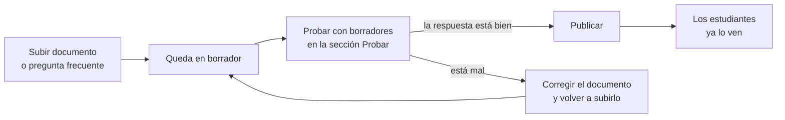

# Manual de la consola de administración

La consola sirve para administrar el asistente sin tocar código. Se abre en `http://localhost:8501` cuando el asistente está encendido (ver [instalacion.md](instalacion.md#encender-y-apagar)).

Si en `.env` hay una clave `ADMIN_TOKEN`, la consola la pide al abrirla (ver [instalacion.md](instalacion.md#clave-de-administración)). Sin clave, cualquiera que llegue a la dirección puede administrar.

Los cambios aplican de inmediato, salvo lo que queda **en borrador**: los documentos y preguntas frecuentes nuevos solo los ve la consola hasta que alguien los publica.

El menú de la izquierda tiene siete secciones: Reuniones, Documentos, Preguntas frecuentes, Asistentes, Personajes, Probar e Historial. Abajo del menú aparece el estado de la conexión con la API y cuántos fragmentos hay indexados.

## Cómo agregar o actualizar información

Es la tarea más frecuente. El camino recomendado es **subir → probar → publicar**:

### Subir un documento

1. Entra a **Documentos**.
2. Elige el archivo. Formatos: PDF, Word (`.docx`), Excel (`.xlsx`), PowerPoint (`.pptx`), CSV, texto (`.txt`) y Markdown (`.md`). Tamaño máximo: 50 MB (se cambia con `MAX_UPLOAD_MB`).
3. Elige una categoría existente o escribe una nueva, por ejemplo el programa (`ITC`, `IMT`) o el tema (`becas`, `servicios`).
4. Deja sin marcar **Publicar de inmediato** si quieres probarlo primero (lo recomendado).
5. Pulsa subir. El documento se guarda, se parte en fragmentos y se indexa.

### Probarlo y publicarlo

1. En **Probar**, con **Con borradores** activado, haz una pregunta que el documento debería contestar. Los fragmentos en borrador aparecen marcados como `BORRADOR`.
2. Si la respuesta es correcta, vuelve a **Documentos**, selecciona el documento y pulsa **Publicar**. El botón **Publicar todos los borradores** publica de una vez todo lo pendiente.
3. Para retirar un documento sin borrarlo, selecciónalo y pulsa **Pasar a borrador**.

### Actualizar un documento

Sube el archivo nuevo con el mismo nombre y la misma categoría. Sustituye al anterior y queda en el estado que elijas al subirlo. Si el archivo nuevo no se puede leer, se conserva el anterior.

### Quitar un documento

En la lista de **Documentos**, selecciónalo y pulsa eliminar. Se borra el archivo y sus fragmentos.

### Agregar una pregunta frecuente

Sirve para respuestas cortas que no vienen en ningún documento.

1. Entra a **Preguntas frecuentes**.
2. Escribe la pregunta, la respuesta y la categoría.
3. Marca **Publicar de inmediato** o déjala en borrador para probarla.
4. Pulsa agregar. Cada pregunta guardada tiene botones para guardar cambios, publicar o pasar a borrador, y eliminar.

El asistente la usa igual que un documento y la cita como fuente.

### Reindexar todo

El botón de reindexar en **Documentos** vuelve a procesar toda la carpeta `data/docs` y las preguntas frecuentes. Úsalo si copiaste archivos a mano en esa carpeta.

### Recomendaciones para los documentos

- Un tema por documento, con títulos claros. El asistente cita el nombre del archivo.
- Texto real, no imágenes escaneadas: de un PDF escaneado no se extrae nada.
- En Excel, una fila por dato y encabezados en la primera fila.
- Fechas completas ("del 3 al 7 de agosto de 2026"), no relativas ("la próxima semana").
- Después de subir algo, pruébalo en la sección **Probar** antes de darlo por bueno.

### Base de conocimiento inicial

El proyecto trae dos documentos de ejemplo con datos ficticios, marcados con `EJEMPLO_` en el nombre:

| Archivo | Categoría | Contenido |
|---|---|---|
| `EJEMPLO_faq_servicios.md` | `general` | Servicios para estudiantes: biblioteca, constancias, baja de materias, asesoría y certificaciones |
| `EJEMPLO_plan_estudios.md` | `ITC` | Plan de estudios de una carrera |

Sirven para probar y demostrar. Antes de un uso real hay que borrarlos y cargar los documentos institucionales.

## Secciones

### Reuniones

Para que el asistente entre a una reunión de Teams.

1. Pega el enlace de la reunión.
2. Elige el asistente y, si quieres, el nombre con el que aparecerá.
3. Pulsa Intro o **Unirse**.

Debajo se ve el estado: preparando, entrando, en la sala de espera, en la reunión o terminada. **Salir de la reunión** lo saca.

Requisitos y límites en [teams.md](teams.md).

### Documentos

Lista de los archivos de la base de conocimiento, con su categoría, estado (**Publicado** o **Borrador**), tamaño y número de fragmentos. Permite subir, publicar o pasar a borrador, eliminar, ver los fragmentos de un documento y reindexar.

Ver los fragmentos sirve para comprobar que el texto se extrajo bien, sobre todo en PDF, Excel y PowerPoint.

### Preguntas frecuentes

Agregar, editar, publicar y eliminar preguntas con su respuesta y su categoría. Cada una muestra su estado.

### Asistentes

Cada asistente es un perfil independiente. Se pueden crear tantos como programas o servicios haya.

| Campo | Para qué |
|---|---|
| Nombre | Cómo se presenta y a qué nombre responde en una reunión |
| Descripción corta | Se ve bajo el nombre en la página del avatar |
| Función | Para qué sirve y a quién atiende. Se le da al modelo como instrucción |
| Estilo y cómo habla | La personalidad. Hay cuatro estilos predefinidos (Cercano, Formal, Breve y directo, Paciente y didáctico) y el texto se puede ajustar |
| Saludo inicial | Lo que dice al empezar |
| Idioma predeterminado | El idioma con el que arranca |
| Personaje y expresión base | La apariencia del avatar, incluidos los personajes propios |
| Motor de voz y voz en cada idioma | Piper (rápida) o Chatterbox (natural, si está instalada) |
| Acceso a la información | Qué puede consultar |
| Nombres en reunión | Variantes del nombre a las que responde en Teams |

**Acceso a la información.** Se eligen categorías completas, documentos sueltos, o ambos. Sin nada elegido, el asistente consulta todo. Lo que no está asignado no le llega: no puede citarlo ni usarlo. Debajo aparece cuántos documentos y preguntas frecuentes puede consultar.

**La personalidad solo cambia el tono.** No cambia los datos ni la regla de contestar únicamente con la información disponible.

Para crear uno, elige "Nuevo…" en la lista, escribe un identificador sin espacios (minúsculas, números, `-` o `_`; por ejemplo `asesor-imt`) y llena los campos.

### Personajes

Lista de personajes 3D con su licencia, y formulario para subir uno propio.

- El archivo debe ser un `.glb` con esqueleto tipo Mixamo, las 52 formas faciales de ARKit y los 15 visemas de Oculus. Los que exportan Ready Player Me, Avaturn o Avatar SDK ya vienen así. Con otro tipo de modelo el personaje aparece, pero los labios y la cara no se mueven.
- Escribe el nombre, el tipo de cuerpo (para la postura y la animación) y la licencia o procedencia.
- Después, asígnalo a un asistente en **Asistentes** → **Personaje**.

Los personajes de ejemplo no se pueden borrar desde aquí; los propios sí.

### Probar

Para hacer una pregunta y ver qué pasa por dentro **antes de publicar** un cambio:

- la respuesta;
- la intención detectada (consulta, saludo, despedida o agradecimiento);
- la pregunta tal como se buscó, ya completada con el contexto;
- los fragmentos que se usaron, con su fuente, qué tan parecidos son a la pregunta y si están en borrador.

El interruptor **Con borradores** está activado por omisión: así se ve cómo contestaría el asistente si publicaras lo pendiente. Desactívalo para ver exactamente lo que ve un estudiante.

Si la respuesta es mala, casi siempre se ve aquí por qué: no se recuperó el fragmento correcto, o el documento no dice lo que se esperaba.

También corre la **evaluación**: una lista de preguntas con respuesta esperada (`tests/preguntas.jsonl`) que dice cuáles pasan. Conviene correrla después de cargar documentos o cambiar un asistente, con o sin borradores.

Las pruebas de esta sección no se guardan en el historial.

### Historial

- Totales: preguntas, cuántas se contestaron, cuántas no, sesiones y valoraciones.
- Gráficas por día, por idioma, por asistente y por intención.
- **Preguntas sin respuesta más repetidas.** Es la lista más útil: dice qué información hace falta cargar.
- Tabla de preguntas, con una columna para valorar cada respuesta como buena o mala. Los estudiantes también valoran con 👍 / 👎 en la página del avatar, y esas valoraciones aparecen aquí.
- **Descargar CSV**: todo el historial en un archivo que abre Excel, para reportes.

Para probar la voz sin avatar ya no hay una sección aparte: la página del avatar hace lo mismo y además muestra al personaje.

## Preguntas habituales

**¿Tengo que reiniciar algo después de un cambio?** No.

**¿Por qué el asistente no usa un documento que acabo de subir?** Porque está en borrador. Publícalo en **Documentos**.

**¿Dónde quedan los datos?** En la carpeta `data/` del proyecto: documentos en `data/docs`, estado de publicación en `data/publicacion.json`, perfiles en `data/perfiles.json`, preguntas frecuentes en `data/faqs.json`, personajes propios en `data/personajes.json` (y sus archivos en `web/avatars/`), historial en `data/historial.jsonl` y valoraciones en `data/valoraciones.json`.

**¿Cómo hago una copia de seguridad?** Copia la carpeta `data/` y `web/avatars/`. El índice (`data/chroma`) se puede regenerar con el botón de reindexar.

**El asistente no encuentra algo que sí está en un documento.** Revisa en **Documentos** que el archivo tenga fragmentos y esté publicado, y en **Probar** qué fragmentos recupera. Si el asistente tiene acceso restringido, revisa que ese documento o su categoría esté asignado.