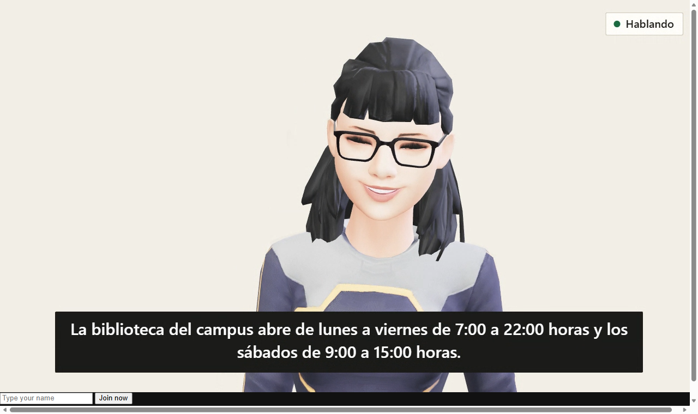
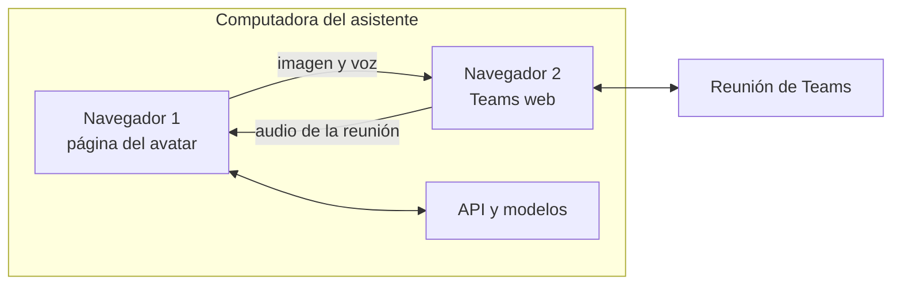

# Integración con Microsoft Teams

El asistente entra a una reunión de Teams como un participante más, con su avatar como cámara y su voz como micrófono, escucha a los demás y contesta cuando dicen su nombre.

## Cómo usarlo

1. Crea la reunión en Teams y entra tú primero. Si nadie la ha empezado, el asistente se queda esperando.
2. En la consola, sección **Reuniones**, pega el enlace y pulsa Intro. Si definiste `ADMIN_TOKEN`, la consola te pide la clave antes.
3. Se abren dos ventanas de navegador en la computadora del asistente: una con el avatar y otra con Teams. No las cierres ni las minimices.
4. Cuando Teams avise que el asistente quiere unirse, admítelo.
5. Para preguntarle, di primero su nombre: "TecBot, ¿qué horario tiene la biblioteca?".

Para sacarlo, pulsa **Salir de la reunión** en la consola. También sale solo cuando la reunión termina o lo quitan.

## Cómo se comporta en la reunión

| Situación | Qué hace |
|---|---|
| Alguien habla sin decir su nombre | Nada |
| "TecBot, ¿...?" | Contesta |
| Solo "TecBot" | Dice "¿Sí? Adelante." y espera la pregunta unos 10 segundos |
| "TecBot, ¿me escuchas?" | Confirma que oye |
| "TecBot, espera" o "gracias, TecBot" mientras habla | Se calla |
| Otra persona habla mientras él contesta | Sigue hablando; solo se calla si lo nombran |

El nombre no tiene que oírse perfecto: se compara por cómo suena, así que "Tec Bot", "Techbot" o "Tech boat" también cuentan. Cada asistente puede tener más nombres en la consola (por ejemplo "Asesor").

La opción "En reunión, deja de hablar", en la configuración de la página del avatar, permite que cualquier voz lo interrumpa, lo que resulta más natural en una sesión de uno a uno.

## Cómo funciona

- Un programa (`app/teams.py`) controla dos navegadores con Playwright, usando el Chrome o Edge ya instalado.
- El primero muestra al avatar y compone una imagen de 1280 por 720 con el personaje, su estado y los subtítulos.
- El segundo abre Teams en su versión web y entra con el enlace. Antes de que cargue Teams se le inyecta un pequeño programa (`app/teams_puente.js`) que, cuando Teams pide la cámara y el micrófono, le entrega la imagen y la voz del avatar.
- Los dos navegadores se pasan imagen y sonido por una conexión WebRTC local. El audio de los demás participantes vuelve por la misma conexión, y así el asistente oye.
- Lo que oye se corta en frases, se transcribe y, si lo nombran, sigue el mismo camino que cualquier pregunta.

No se usa OBS, ni cámaras o micrófonos virtuales, ni cuentas o permisos de Microsoft.

## Reglas de seguridad

- **Solo como invitado.** El asistente escribe su nombre en la pantalla de entrada y espera a que lo admitan.
- **Nunca usa cuentas de la computadora.** Si el navegador inicia sesión solo con una cuenta de Windows, o la reunión exige iniciar sesión, la entrada se cancela y la consola lo dice.
- **Nunca abre la aplicación de Teams instalada.** Los enlaces que la lanzan se bloquean.
- **Ventana sin perfil.** No guarda nada al cerrarse.
- **No se oculta que es un programa** ni se intentan pasar verificaciones de persona.

## Qué se probó

| Prueba | Resultado |
|---|---|
| Entrar como invitado a una reunión de Teams personal (`teams.live.com`) | Funciona: entró, lo admitieron y quedó con cámara y micrófono encendidos |
| Teams acepta la imagen del avatar como cámara | Sí, visible en la pantalla previa y en la reunión |
| Oye a los participantes | Sí: transcribió frases dichas desde otro dispositivo |
| Reconoce su nombre y contesta en la reunión | Sí |
| Permanece estable | Unos 8 minutos seguidos sin caerse |
| Entrada, saludo y salida contra una reunión simulada | Automatizado en `tests/integracion/puente.py` |
| Bloqueo de la aplicación de Teams y regla de solo invitado | Probado con la reunión simulada |

## Límites conocidos

- **Reuniones de la cuenta institucional.** En las reuniones de `teams.microsoft.com` de la cuenta del Tec, Teams manda a iniciar sesión, y el asistente cancela la entrada. Para esas reuniones haría falta que la organización permita invitados anónimos, o un bot oficial (ver [evolucion.md](evolucion.md)).
- **Cambios de Teams.** El programa depende de los botones de la página de Teams. Si Microsoft los cambia, hay que actualizar los selectores en `app/teams.py`.
- **Una reunión a la vez** por computadora.
- **Alguien tiene que admitirlo** si la reunión tiene sala de espera.
- **Pausas largas.** Una pausa de casi un segundo a media pregunta la corta en dos.
- **No distingue quién habla.** Todas las voces llegan mezcladas.
- **Después de los últimos cambios** (regla de solo invitado y estilo nuevo) no se repitió la prueba en una reunión real, solo en la simulada.
- **Idioma fijo en la reunión.** En modo reunión el asistente escucha en el idioma del perfil; la detección automática de idioma solo aplica en la página del avatar.

La ruta anterior con OBS y cables de audio virtuales se retiró del proyecto: la conexión directa la sustituye y el audio por cables nunca llegó a probarse. Queda en el historial de git si alguna vez hace falta.
